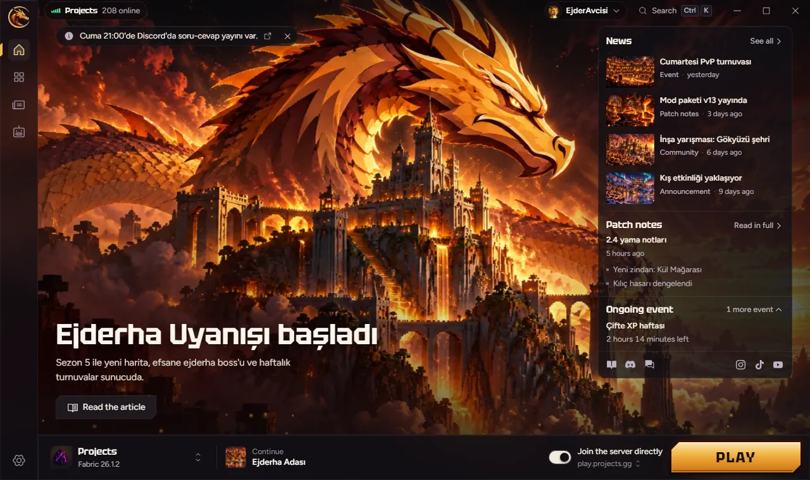
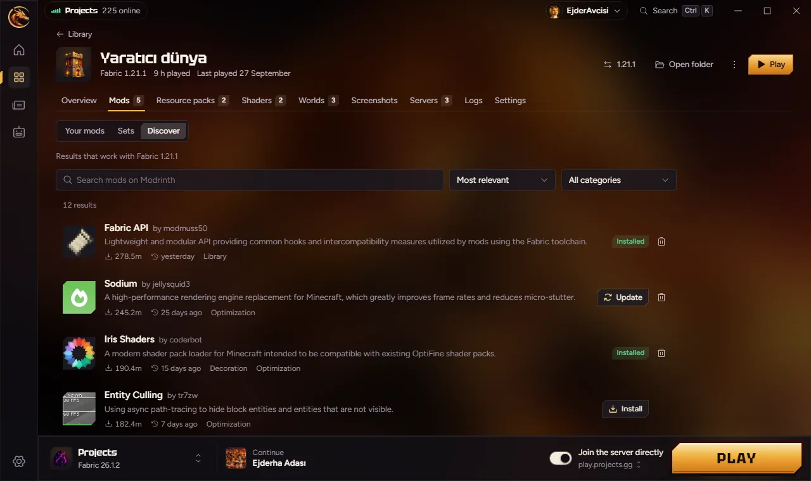

<div align="center">


# Projects Launcher

The Minecraft launcher of [projects.gg](https://projects.gg) for Windows, macOS and Linux.

[](LICENSE)
[](https://projects.gg/discord)



</div>

## What it does

- **Instances.** Any Minecraft release with Fabric, Quilt, Forge or NeoForge. Each instance has
  its own Java, memory, JVM arguments, mods, resource packs, shaders, worlds, screenshots and
  servers.
- **Mods from Modrinth.** Search, install and update mods, packs and shaders with their
  dependencies. Import `.mrpack`, Prism Launcher, MultiMC and CurseForge instances; export
  `.mrpack`.
- **The Projects modpack.** The official instance follows the pack the team publishes and syncs
  before each launch. Mods you add or turn off stay as you left them.
- **Home.** Server news, patch notes and event countdowns, updated without a launcher update.
- **Accounts.** Microsoft sign-in in your browser, or play with a username. Several accounts,
  one click to switch; skins and capes for Microsoft accounts. Tokens live in the OS keychain.
- **AFK accounts.** Keep extra accounts on a server with the Projects Console Client.
- **Works offline.** Installed games and cached content are enough to play.
- **Desktop.** Tray icon, start with the computer, `projects://` links, a Ctrl+K command palette,
  Discord Rich Presence and help when the game crashes.
- **Moving from v1.** Your username, Microsoft session, AFK accounts, worlds, screenshots and
  packs come over on first start.

The launcher is in Turkish and English and updates itself from signed stable and beta channels.

<p align="center">
  
</p>

## Download

Get the installer from [projects.gg](https://projects.gg/indir/) or from
[Releases](https://github.com/projects-gg/MinecraftLauncher/releases). Installed launchers update
themselves. Windows files follow our
[code signing policy](https://projects.gg/kod-imzalama/#en).

Questions and feedback: [Discord](https://projects.gg/discord) (Turkish).

## Build from source

You need Rust stable (`rust-toolchain.toml`), Node 22+, pnpm 10 and the
[Tauri prerequisites](https://tauri.app/start/prerequisites/) for your OS.

```sh
pnpm install
pnpm dev                     # the launcher with hot reload
pnpm dev:web                 # the UI alone in a browser, with mock data
cargo test --workspace       # Rust tests
pnpm lint && pnpm typecheck && pnpm test
```

A local Windows installer needs an updater signing key in `TAURI_SIGNING_PRIVATE_KEY`:

```sh
pnpm --filter @pl/launcher tauri build --bundles nsis
```

Release builds for all three systems come from GitHub Actions on a `v*` tag
(`.github/workflows/release.yml`). The in-game overlay mod builds with Gradle and Java 25:
`cd mods/projects-overlay && ./gradlew build`.

**Microsoft sign-in in forks.** Register your own app at
[portal.azure.com](https://portal.azure.com) (App registrations, personal Microsoft accounts
only, redirect URI `http://localhost` as a public client, "Allow public client flows" on) and put
its client id into `CLIENT_ID` in `crates/pl-auth/src/config.rs`. Client ids are public values.

## Repository

```
apps/launcher           Tauri 2 app: React UI (src) and Rust shell (src-tauri)
crates/pl-mc            Versions, installs, Java, launching, instances, loaders, mods, Modrinth, modpacks
crates/pl-auth          Microsoft and username accounts, keychain, skins
crates/pl-content       Signed content: news, home, the official pack
crates/pl-*             Downloads, data folder, desktop links, Discord, imports and more
mods/projects-overlay   In-game overlay (Fabric mod)
packages/ui             Shared design system
```

The signed content format that the launcher reads is described in
[`docs/content-format.md`](docs/content-format.md). Crates never depend on Tauri; the app exposes
typed commands and `apps/launcher/src/bindings.ts` is generated with
`cargo run -p projects-launcher --features export-bindings --bin export-bindings`. Code, comments
and commit messages are in English.

## License

[GNU General Public License v3.0](LICENSE) (`GPL-3.0-only`), including the overlay mod, unless a
file header says otherwise.
